<div align="center">

<table border="0" width="100%">
  <tr>
    <td width="28%" align="center" valign="middle">
      <a href="https://dhigveerrajug.github.io/Vishwakarma/">
        
      </a>
    </td>
    <td width="72%" valign="middle" align="left">
      <h1>⚡ Dhigveerraju G</h1>
      <p><b>Robotics &amp; Artificial Intelligence Engineer • Cyber-Physical Systems Architect</b></p>
      <p>
        <a href="https://git.io/typing-svg">
          
        </a>
      </p>
      <p>
        <a href="https://dhigveerrajug.github.io/Vishwakarma/">
          
        </a>
        <a href="https://in.linkedin.com/in/dhigveerraju-g-69737036b">
          
        </a>
        <a href="https://github.com/DhigveerrajuG/Vishwakarma">
          
        </a>
      </p>
    </td>
  </tr>
</table>

</div>

---

### 📡 Real-Time Edge Vision Telemetry HUD

<p align="center">
  
</p>

---

### 🤖 RoboGuide AI Companion Terminal *(Click Questions to Interact)*

<details open>
  <summary><b>💬 "What is Dhigveer's core engineering philosophy?"</b></summary>
  <blockquote>
    🤖 <b>RoboGuide:</b> "I believe true robotics begins when your software directly commands mechanical torque, velocity, and physical inertia. My work bridges <b>embedded microcontroller firmware, real-time sensor telemetry, and edge deep learning</b> into dependable cyber-physical systems."
  </blockquote>
</details>

<details>
  <summary><b>🛡️ "How does Conveyor Sentinel AI achieve 42+ FPS anomaly classification?"</b></summary>
  <blockquote>
    🤖 <b>RoboGuide:</b> "It utilizes an Ultralytics <b>YOLOv8</b> neural network fine-tuned on tear, puncture, and fray patterns, coupled with an adaptive <b>OpenCV</b> morphological contour tracker. When an anomaly exceeds defect criticality, an automated 5-point routine triggers a safety relay cutoff in <b>&lt;22ms</b>."
  </blockquote>
</details>

<details>
  <summary><b>⚡ "Why use mathematical PWM acceleration ramping in motor firmware?"</b></summary>
  <blockquote>
    🤖 <b>RoboGuide:</b> "Direct full-voltage starts cause massive inrush current spikes (up to 3.2A) and mechanical belt inertia slippage. My custom C++ firmware on Arduino Timer1 phase-correct PWM (31.37 kHz) ramps duty cycles linearly, attenuating inrush current by <b>56%</b>."
  </blockquote>
</details>

<details>
  <summary><b>📄 "How do recruiters and collaborators access the official printable resume?"</b></summary>
  <blockquote>
    🤖 <b>RoboGuide:</b> "To protect proprietary firmware IP, official printable CV sheets are access-protected. You can request access instantly through the form at <a href='https://dhigveerrajug.github.io/Vishwakarma/'>Vishwakarma Portfolio</a> or unlock immediately using an approved passcode token!"
  </blockquote>
</details>

---

### 🔬 Interactive Flagship Engineering Laboratories *(Click Tabs to Inspect)*

#### 1. Conveyor Sentinel AI — Autonomous Industrial Belt Inspection System
*Real-time edge computer vision pipeline detecting surface anomalies on moving conveyor lines.*

<details open>
  <summary><b>📐 Architecture &amp; Safety Protocol</b></summary>
  <ul>
    <li><b>Dual-Stage Vision Pipeline:</b> Primary lightweight YOLOv8 object detector coupled with OpenCV morphological contour tracking for high-speed motion blur mitigation.</li>
    <li><b>Real-Time Reticle HUD:</b> Dynamic bounding box coordinate overlays marking detected cracks with confidence ratings at <b>42.4 FPS</b>.</li>
    <li><b>Safety Interlock Protocol:</b> Automated 5-point routine communicating criticality thresholds to active-low industrial safety stop relays in <b>&lt;22ms</b>.</li>
  </ul>
</details>

<details>
  <summary><b>💻 View Source Code: detect_conveyor_tears.py</b></summary>

```python
import cv2
import numpy as np
from ultralytics import YOLO

class ConveyorSentinelAI:
    def __init__(self, model_path="weights/yolov8n_conveyor_v2.pt", relay_pin=18):
        self.model = YOLO(model_path)
        self.relay_pin = relay_pin

    def process_frame(self, frame: np.ndarray):
        results = self.model.predict(source=frame, conf=0.72, verbose=False)[0]
        critical_anomaly = False

        for box in results.boxes:
            cls_id = int(box.cls[0])
            conf = float(box.conf[0])
            if cls_id in (0, 1) and conf >= 0.85:
                critical_anomaly = True
                self.trigger_safety_interlock(box.xyxy[0].tolist(), conf)

        if not critical_anomaly:
            gray = cv2.cvtColor(frame, cv2.COLOR_BGR2GRAY)
            blurred = cv2.GaussianBlur(gray, (5, 5), 0)
            _, thresh = cv2.threshold(blurred, 45, 255, cv2.THRESH_BINARY_INV)
            contours, _ = cv2.findContours(thresh, cv2.RETR_EXTERNAL, cv2.CHAIN_APPROX_SIMPLE)
            for cnt in contours:
                if cv2.contourArea(cnt) > 850:
                    critical_anomaly = True

        return results, critical_anomaly

    def trigger_safety_interlock(self, coords, confidence):
        print(f"[ALERT] Critical defect detected ({confidence*100:.1f}%). Triggering E-STOP relay!")
```
</details>

<details>
  <summary><b>🔌 Hardware Specifications &amp; Pinout</b></summary>

| Parameter | Specification |
| :--- | :--- |
| **Inference Resolution** | 640x640 letterboxed input |
| **Target Frame Rate** | 42.4 FPS on Edge TPU (TensorRT FP16) |
| **Classification Classes** | Longitudinal Tear, Deep Puncture, Edge Fray, Foreign Debris |
| **Interlock Relay Response** | &lt; 22ms active-low GPIO cutoff |
| **Camera Interface** | MIPI CSI-2 / USB 3.0 Global Shutter (120 FPS capable) |

</details>

<p>
  <a href="https://github.com/DhigveerrajuG/Autonomous-Industrial-Conveyor-Belt-Inspection-System">
    
  </a>
</p>

---

#### 2. Synchronized Dual-Motor Actuation & PWM Firmware
*Embedded C++ firmware executing mathematical PWM acceleration ramping for dual DC motors.*

<details open>
  <summary><b>📐 Acceleration Curves &amp; Inrush Attenuation</b></summary>
  <ul>
    <li><b>PWM Soft-Start Ramping:</b> Mathematical acceleration curves written in C++ that step PWM duties linearly to eliminate belt inertia slippage and protect gearboxes.</li>
    <li><b>Inrush Current Damping:</b> Dampens inrush spikes through dual L298N H-Bridge drivers, attenuating peak current from 3.2A to 1.4A (56% reduction).</li>
    <li><b>Closed-Loop Tachometer:</b> Optical encoder integration monitoring rotational RPM under dynamic mechanical load.</li>
  </ul>
</details>

<details>
  <summary><b>💻 View Source Code: synchronized_drive.cpp</b></summary>

```cpp
#include <Arduino.h>

const uint8_t ENA_PIN = 9;   // Timer1 PWM (Motor A)
const uint8_t ENB_PIN = 10;  // Timer1 PWM (Motor B)
const uint8_t IN1_PIN = 4;
const uint8_t IN2_PIN = 5;
const uint8_t IN3_PIN = 6;
const uint8_t IN4_PIN = 7;

const uint8_t TARGET_DUTY = 220;       // 86% Max Duty Cycle
const uint8_t RAMP_STEP_DELAY_MS = 18; // Step delay prevents inrush spike

void setupMotorTimers() {
    TCCR1B = (TCCR1B & 0b11111000) | 0x01; // 31.37 kHz ultrasonic PWM
    pinMode(ENA_PIN, OUTPUT); pinMode(ENB_PIN, OUTPUT);
    pinMode(IN1_PIN, OUTPUT); pinMode(IN2_PIN, OUTPUT);
    pinMode(IN3_PIN, OUTPUT); pinMode(IN4_PIN, OUTPUT);
}

void executeSoftStartRamping(uint8_t targetDuty) {
    digitalWrite(IN1_PIN, HIGH); digitalWrite(IN2_PIN, LOW);
    digitalWrite(IN3_PIN, HIGH); digitalWrite(IN4_PIN, LOW);
    for (uint8_t duty = 0; duty <= targetDuty; duty += 4) {
        analogWrite(ENA_PIN, duty);
        analogWrite(ENB_PIN, duty);
        delay(RAMP_STEP_DELAY_MS);
    }
}
```
</details>

<details>
  <summary><b>🔌 Hardware Ratings &amp; Circuit Diodes</b></summary>

| Parameter | Value |
| :--- | :--- |
| **Operating Motor Voltage** | 12V - 24V DC unregulated rail |
| **Peak Inrush Current (Unramped)** | 3.2A per motor channel |
| **Soft-Start Current Peak** | 1.4A (56% inrush attenuation) |
| **PWM Timer Base Frequency** | 31.37 kHz ultrasonic phase-correct PWM |
| **Back-EMF Snubber Array** | 1N5819 Schottky fast-recovery flyback diodes |
| **Logic Isolation** | PC817 Optocoupler opto-isolated control lines |

</details>

---

#### 3. Vishwakarma Engineering Portfolio
*Interactive cyber-physical portfolio featuring stationary RoboGuide AI companion and connected dual-backend.*

<details open>
  <summary><b>📐 Dual-Ready Backend &amp; Static Resilience</b></summary>
  <ul>
    <li><b>Java 26 Virtual Threads Backend:</b> Zero-dependency lightweight HTTP server utilizing Java's <code>com.sun.net.httpserver</code> with Virtual Threads for high concurrency.</li>
    <li><b>Node.js Connected API:</b> REST endpoints for contact transmissions (<code>/api/contact</code>), resume authorization (<code>/api/resume-request</code>), and copilot dialogue (<code>/api/chat</code>).</li>
    <li><b>Offline / Static Fallback:</b> Client-side fallback guarantees 100% feature availability on static hosts like GitHub Pages.</li>
  </ul>
</details>

<p>
  <a href="https://dhigveerrajug.github.io/Vishwakarma/">
    
  </a>
  <a href="https://github.com/DhigveerrajuG/Vishwakarma">
    
  </a>
</p>

---

#### 4. Robotics Kinematics &amp; Actuation Lab
*Precision motion control and kinematics on high-torque 12V DC actuators with quadrature optical encoders.*

<details open>
  <summary><b>📐 Closed-Loop Optical Encoder Feedback</b></summary>
  <ul>
    <li>Continuous quadrature optical encoder count tracking (500 CPR, 2000 edges/rev) to eliminate positional drift under mechanical load.</li>
    <li>Proportional trim control keeping dual roller shafts synchronized within <b>±2 encoder ticks</b>.</li>
    <li>Engineered on TETRIX PRIZM 32-bit Cortex robotics controller.</li>
  </ul>
</details>

<details>
  <summary><b>💻 View Source Code: prizm_encoder_kinematics.cpp</b></summary>

```cpp
#include <PRIZM.h>
PRIZM prizm;

void setup() {
    prizm.PrizmBegin();
    prizm.setMotorInvert(1, 1);
    prizm.resetEncoders();
}

void loop() {
    long countM1 = prizm.readEncoderCount(1);
    long countM2 = prizm.readEncoderCount(2);
    long error = countM1 - countM2;

    int trim = (int)(error * 0.45);
    prizm.setMotorPowers(125 - trim, 125 + trim);
    delay(10);
}
```
</details>

---

### 🛠️ Technical Arsenal

<div align="center">

#### 🤖 Robotics & Embedded Systems


#### 👁️ Computer Vision & Edge AI


#### 💻 Software & Connected Infrastructure


</div>

---

### 📊 GitHub Activity & Real-Time Telemetry

<div align="center">
  <table border="0">
    <tr>
      <td align="center">
        
      </td>
      <td align="center">
        
      </td>
    </tr>
    <tr>
      <td colspan="2" align="center">
        
      </td>
    </tr>
  </table>
</div>

---

### 📬 Connect & Official Resume Access

- 🌐 **Live Portfolio**: [dhigveerrajug.github.io/Vishwakarma](https://dhigveerrajug.github.io/Vishwakarma/)
- 💼 **LinkedIn**: [Dhigveerraju G](https://in.linkedin.com/in/dhigveerraju-g-69737036b)
- 🐙 **GitHub**: [@DhigveerrajuG](https://github.com/DhigveerrajuG)
- 📄 **Official Resume Access**: To protect proprietary firmware and engineering IP, official printable CV downloads are authorized through the portfolio access portal.

<br/>

<div align="center">
  <sub>Engineered with Physical Intelligence & Autonomous Robotics 🤖 • © 2026 Dhigveerraju G</sub>
</div>
