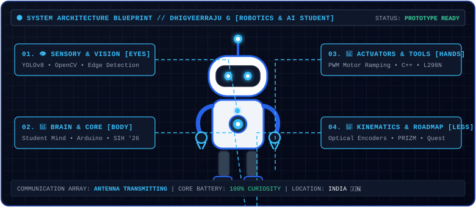

# 🤖 ROBOTICS UNIT // DHIGVEERRAJU G
**Autonomous Hardware &amp; Edge AI Explorer • Student Architecture Blueprint**

  

---

## 📡 00. THE ANTENNA // Communication &amp; Identity

> *"I am a Robotics and Artificial Intelligence student in India. I don't claim to be an expert in everything—I'm an explorer who believes the best way to understand intelligent machines is by wiring circuits, writing code, and testing real physical mechanisms."*

- 📍 **Base Station**: India 🇮🇳 (Undergraduate Student in Robotics &amp; AI)
- 📡 **Signal Mode**: Constantly prototyping, debugging breadboards, and training edge vision models.
- 🚀 **Live Transmitter**: I built **[Vishwakarma](https://dhigveerrajug.github.io/Vishwakarma/)**, an interactive web experience showcasing my hardware experiments and companion drone.
- 🤝 **Open Frequency**: Seeking student internships, summer research, open-source robotics collaborations, and mentorship!

---

## 👁️ 01. THE EYES // Optical Sensors, Computer Vision &amp; Edge AI
*How the robot perceives and interprets the visual world.*

This anatomical section represents my exploration into **Computer Vision** and **Edge Deep Learning**—giving machines the ability to see and react to their environment in real time.

- **Primary Vision Engine**: **Ultralytics YOLOv8** object detection fine-tuned on custom industrial anomaly datasets.
- **Image Processing Library**: **OpenCV** (contour detection, adaptive thresholding, motion blur filtering).
- **Languages**: Python 3.

### 🛡️ Flagship Vision Project: *Conveyor Sentinel AI*

  
<b>🔍 Inspect Vision Module: Real-Time Belt Defect Detection</b>

   
  <blockquote>
    <b>The Purpose:</b> Act as the autonomous optical eyes of an industrial conveyor line, spotting surface tears, punctures, and cracks at <b>42+ FPS</b> before expensive belt breakdowns occur. 
    <b>What I Did:</b> Trained a lightweight YOLOv8 detector on tear and defect patterns, paired with OpenCV morphological contour tracking to handle moving belt motion blur. 
    <b>What I Learned as a Student:</b> Processing frames quickly is only useful if the system can act immediately. I learned to design a low-latency trigger that communicates to an active-low safety cutoff relay in <b>&lt;22ms</b>.
  </blockquote>
  

    
  

---

## 🧠 02. THE BRAIN &amp; TORSO // Central Processing &amp; Student Core
*The logic, decision-making, and student learning philosophy powering the machine.*

This section houses the computing controllers, logic workflows, and core hackathon architectures.

- **Microcontrollers &amp; Processing**: Arduino UNO (ATMega328P), TETRIX PRIZM (32-bit Cortex processor).
- **Core Logic Languages**: C, C++, Python.
- **The Student Mindset**: I treat component failures and syntax bugs as "datasheets in disguise"—probing with a multimeter, reading datasheets, and isolating variables.

### 🏆 Core Hackathon Build: *Smart India Hackathon (SIH '26) Operations Engine*

  
<b>⚙️ Inspect Processing Core: Hackathon Incident Desk</b>

   
  <blockquote>
    <b>The Purpose:</b> Serve as the central nervous system for hackathon operations, tracking on-ground grievances, team logistics, and verification passes. 
    <b>What I Did:</b> Developed a responsive, fast operations portal with transaction-safe ticket generation and real-time status updates. 
    <b>What I Learned:</b> How to architect software rapidly under high-pressure deadlines, prioritize core user needs, and collaborate effectively with a team.
  </blockquote>
  

    
  

---

## 🦾 03. THE ARMS &amp; HANDS // Actuation, Motors &amp; Workshop Tools
*How the robot interacts with the physical world—applying mechanical torque and manipulating hardware.*

This section represents my hands-on hardware prototyping: driving motors, designing PWM acceleration curves, and working with tools on the workbench.

- **Actuation Hardware**: L298N Dual H-Bridge Drivers, 12V DC Gearmotors, Optocouplers, 1N5819 Schottky Flyback Diodes, Relays.
- **Firmware Techniques**: Phase-Correct PWM (31.37 kHz ultrasonic), Timer Prescaling, Interrupt Service Routines (ISR).
- **Workbench Tools**: VS Code, Arduino IDE, Digital Multimeter, Soldering Iron, Breadboards, Wire Strippers.

### ⚡ Flagship Actuation Project: *Synchronized Dual-Motor PWM Firmware*

  
<b>🔧 Inspect Manipulator System: Soft-Start Acceleration Firmware</b>

   
  <blockquote>
    <b>The Purpose:</b> Drive dual industrial conveyor rollers smoothly without belt slippage, gearbox shock, or electrical driver burnout. 
    <b>What I Did:</b> Wrote custom C++ firmware utilizing Arduino Timer1 phase-correct PWM. Instead of sending instant 100% duty cycle, I programmed mathematical duty stepping across 18ms intervals. 
    <b>What I Learned:</b> Direct full-voltage starting creates massive inrush current spikes (up to 3.2A per motor). Soft-start mathematical ramping attenuates peak inrush by <b>56%</b> (down to 1.4A), eliminating thermal cutouts and belt jerk.
  </blockquote>

---

## 🦿 04. THE LEGS &amp; POWERTRAIN // Kinematics, Encoders &amp; Learning Roadmap
*What gives the machine stability, closed-loop locomotion, and direction forward.*

This section represents closed-loop feedback control and my forward-stepping **learning quest** as a student.

- **Kinematics &amp; Feedback**: Quadrature Optical Encoders, Gear Ratios, Velocity Matching, Proportional Trimming.
- **Platform**: TETRIX PRIZM Robotics Competition Controller.

### 🔬 Kinematics Prototyping: *Closed-Loop Motor Synchronization*

  
<b>📐 Inspect Powertrain: Quadrature Encoder Trimming</b>

   
  <blockquote>
    <b>The Purpose:</b> Prevent physical drift between two drive shafts operating under variable mechanical loads. 
    <b>What I Did:</b> Connected quadrature optical encoders (500 CPR, 2000 edges/rev) to track shaft rotations and executed proportional trimming to keep both motors synchronized within <b>±2 encoder ticks</b>. 
    <b>What I Learned:</b> Open-loop systems always drift in the physical world due to friction and load variations; real-time encoder feedback is fundamental to precise robotics.
  </blockquote>

### 🗺️ The Forward Step: *My Student Learning Roadmap*
<table border="0" width="100%">
  <tr>
    <td width="50%" valign="top">
      <h4>👣 Current Grounding (What I Can Build)</h4>
      <ul>
        <li>Arduino firmware in <b>C / C++</b>.</li>
        <li>Motor actuation: PWM ramping, H-bridges, relays.</li>
        <li>Training custom <b>YOLOv8</b> detection models.</li>
        <li>Basic computer vision pipelines with <b>OpenCV</b>.</li>
        <li>Modern front-end web interfaces (HTML5, CSS, JS).</li>
        <li>Version control with Git &amp; GitHub.</li>
      </ul>
    </td>
    <td width="50%" valign="top">
      <h4>🎯 Stepping Forward (What I'm Learning Next)</h4>
      <ul>
        <li><b>ROS / ROS2</b> node communications &amp; topics.</li>
        <li>Inverse kinematics for multi-degree-of-freedom robotic arms.</li>
        <li>Deploying vision models to <b>NVIDIA Jetson</b> with TensorRT.</li>
        <li>PID tuning for sub-millimeter position control.</li>
        <li>Sensor fusion (IMU + wheel encoders + optical sensors).</li>
      </ul>
    </td>
  </tr>
</table>

---

## 📊 05. TELEMETRY &amp; DIAGNOSTICS // Real-Time Activity &amp; Status
*Output transmission from the robot's core to the developer community.*

<table border="0" width="100%">
  <tr>
    <th align="left">Robotic Subsystem</th>
    <th align="left">Active Repository</th>
    <th align="left">Core Stack</th>
    <th align="center">Subsystem Status</th>
  </tr>
  <tr>
    <td>👁️ <b>Sensory / Vision</b></td>
    <td><b><a href="https://github.com/DhigveerrajuG/Autonomous-Industrial-Conveyor-Belt-Inspection-System">Conveyor Sentinel AI</a></b></td>
    <td><code>YOLOv8</code> • <code>OpenCV</code> • <code>Python</code></td>
    <td align="center"></td>
  </tr>
  <tr>
    <td>🌐 <b>Interface / Comms</b></td>
    <td><b><a href="https://github.com/DhigveerrajuG/Vishwakarma">Vishwakarma Portfolio</a></b></td>
    <td><code>TypeScript</code> • <code>Dual Backend</code> • <code>HTML5</code></td>
    <td align="center"></td>
  </tr>
  <tr>
    <td>🧠 <b>Central Core</b></td>
    <td><b><a href="https://github.com/DhigveerrajuG/GBlr26sIh">GBlr26sIh</a></b></td>
    <td><code>SIH '26</code> • <code>Web UI</code> • <code>Apps Script</code></td>
    <td align="center"></td>
  </tr>
</table>

   
  <table border="0">
    <tr>
      <td align="center">
        
      </td>
      <td align="center">
        
      </td>
    </tr>
  </table>

---

## 📬 06. TRANSMIT MESSAGE // Connect With Dhigveer

Are you a **fellow student**, an **experienced engineer**, or a **hiring team** looking for an enthusiastic robotics intern? I'd love to connect!

- 🌐 **Interactive Portfolio**: [dhigveerrajug.github.io/Vishwakarma](https://dhigveerrajug.github.io/Vishwakarma/)
- 💼 **LinkedIn**: [Dhigveerraju G](https://in.linkedin.com/in/dhigveerraju-g-69737036b)
- 🐙 **GitHub**: [@DhigveerrajuG](https://github.com/DhigveerrajuG)
- 📧 **Direct Transmission**: [dhigveerraju@gmail.com](mailto:dhigveerraju@gmail.com)

 

  Robot Unit Dhigveer-01 • Powered by curiosity and physical intelligence 🤖 • © 2026 Dhigveerraju G

