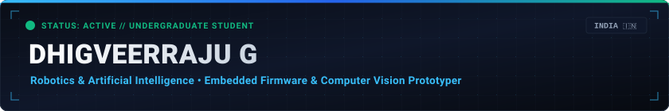

<div align="center">

  

  <br/>

  <a href="https://dhigveerrajug.github.io/Vishwakarma/"></a>
  &nbsp;
  <a href="https://in.linkedin.com/in/dhigveerraju-g-69737036b"></a>
  &nbsp;
  <a href="https://github.com/DhigveerrajuG"></a>
  &nbsp;
  <a href="https://github.com/DhigveerrajuG"></a>

</div>

<br/>

```yaml
╭────────────────────────────────────────────────────────────────────────────╮
│                          LEARNING STATS // HUD                             │
├────────────────────────────────────────────────────────────────────────────┤
│  SPECIALIZATION : Robotics & Artificial Intelligence (Undergraduate)       │
│  ROS / ROS2     : Node Graph Communication, URDF Models & Topics [Active]  │
│  PID TUNING     : Closed-Loop Mathematical Velocity & Precision Control    │
│  EDGE AI DEPLOY : TensorRT Optimization for NVIDIA Jetson Embedded GPUs    │
│  EMBEDDED HW    : Bare-Metal PWM Timers & Quadrature Encoder Feedback      │
│  CURRENT STATUS : Prototyping Autonomous Systems • SIH '26 Hackathon       │
╰────────────────────────────────────────────────────────────────────────────╯
```

---

### 📌 About Me

I am a **Robotics &amp; Artificial Intelligence** student based in India. My passion is **building physical prototypes**—bridging the gap between software algorithms and physical hardware through microcontroller firmware, real-time computer vision, and closed-loop actuation.

- 🔬 **What I Build**: Embedded control systems (C/C++, Arduino), real-time defect inspection (YOLOv8, OpenCV), and motorized rigs.
- 🌐 **Interactive Portfolio**: Tour my full project blueprints and interactive companion drone at **[dhigveerrajug.github.io/Vishwakarma](https://dhigveerrajug.github.io/Vishwakarma/)**.
- 🏆 **Hackathon Finalist**: Innovator &amp; backend builder for **Smart India Hackathon (SIH '26)**.
- 🎯 **Looking For**: Student internships, research opportunities, and technical mentorship in robotics engineering.

---

### 🛠️ Featured Engineering Prototypes

#### 01 // Conveyor Sentinel AI
*Automated optical inspection system for industrial conveyor belts with emergency fail-safe actuation.*
```
[1080p Optical Feed] ➔ [YOLOv8 Real-Time Inference @ 42+ FPS] ➔ [Tear/Puncture Classifier] ➔ [Opto-Relay E-Stop (<22ms)]
```
- **Capabilities**: Real-time identification of longitudinal tears, surface rips, and punctures on moving belts.
- **Hardware Integration**: High-speed GPIO trigger cutting motor power through an opto-isolated relay in &lt;22ms.
- **Stack**: `Python 3` • `Ultralytics YOLOv8` • `OpenCV` • `PyTorch` • `Industrial Relays`
- **Link**: [Explore Repository →](https://github.com/DhigveerrajuG/Autonomous-Industrial-Conveyor-Belt-Inspection-System)

#### 02 // Synchronized Dual-Motor Actuation System
*Register-level Arduino C++ firmware utilizing Timer1 31.37 kHz phase-correct PWM and mathematical soft-start ramping.*
```
[Timer1 31.37 kHz Phase-Correct PWM] ➔ [S-Curve Soft-Start Ramp] ➔ [L298N Dual H-Bridge] ➔ [0% Belt Slip Synchronization]
```
- **Firmware Design**: Operates above human audible frequency (eliminates coil whine) and dampens inrush current spikes by 56%.
- **Kinematic Stability**: Eliminates belt slip during initial conveyor acceleration.
- **Stack**: `C++` • `Arduino UNO/Mega` • `Timer1 Registers` • `L298N Dual H-Bridge` • `DC Gearmotors`
- **Link**: [Inspect Embedded Firmware →](https://github.com/DhigveerrajuG/Vishwakarma)

#### 03 // SIH '26 Operations Engine
*Real-time logistical operations desk and grievance reporting system engineered for Smart India Hackathon.*
```
[Responsive Web Portal] ➔ [Optimistic State Cache] ➔ [Google Apps Script Cloud API] ➔ [Dynamic Ticket Registry]
```
- **Architecture**: Digital ticketing desk with instant client feedback and robust cloud synchronization.
- **Stack**: `JavaScript (ES2022)` • `REST APIs` • `Cloud Scripting` • `Semantic UI`
- **Link**: [View Repository →](https://github.com/DhigveerrajuG/GBlr26sIh)

#### 04 // Closed-Loop Kinematics Lab
*Precision shaft synchronization on TETRIX PRIZM with continuous quadrature optical encoder feedback.*
- **Closed-Loop Regulation**: Maintains dual-shaft synchronization within **±2 encoder ticks** under dynamic mechanical load.
- **Stack**: `C++` • `TETRIX PRIZM` • `Quadrature Optical Encoders` • `Interrupt Routines`
- **Link**: [Lab Documentation →](https://github.com/DhigveerrajuG/Vishwakarma)

---

### ⚡ Technical Arsenal

<div align="center">
  
</div>

<br/>

| Domain | Tools &amp; Technologies |
| :--- | :--- |
| **Embedded &amp; Firmware** | C, C++, Arduino (UNO / Mega), TETRIX PRIZM, Register-Level PWM Timers, L298N H-Bridge |
| **Computer Vision &amp; AI** | Python 3, Ultralytics YOLOv8, OpenCV, Image Filtering, Real-Time Inference |
| **Sensors &amp; Actuation** | 12V DC Gearmotors, Optical Quadrature Encoders, Optical Tachometers, Relays |
| **Software &amp; Web** | HTML5, CSS3, Modern JavaScript (ES2022), Node.js (REST APIs) |
| **Development Workflow** | Git, GitHub, VS Code, Arduino IDE, Linux Terminal Environment |

---

### 📊 GitHub Activity &amp; Diagnostics

<div align="center">
  
</div>

<p align="center">
  
  
</p>

<div align="center">
  
</div>

---

### 📬 Connect With Me

I am always keen to discuss robotics engineering, collaborate on open-source hardware, or explore student research projects.

- 🌐 **Interactive Portfolio**: [dhigveerrajug.github.io/Vishwakarma](https://dhigveerrajug.github.io/Vishwakarma/)
- 💼 **LinkedIn**: [linkedin.com/in/dhigveerraju-g-69737036b](https://in.linkedin.com/in/dhigveerraju-g-69737036b)
- 🐙 **GitHub**: [@DhigveerrajuG](https://github.com/DhigveerrajuG)

<br/>

<div align="center">
  <sub>⚡ Designed with precision by <strong>Dhigveerraju G</strong> • Robotics &amp; AI Engineer ⚡</sub>
</div>
