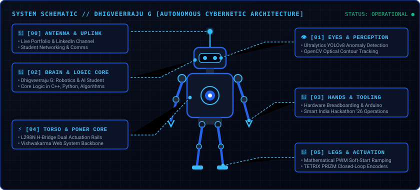

<div align="center">

# ⚙️ Dhigveerraju G
### Robotics &amp; Artificial Intelligence Student • Physical Systems Prototyper

[](https://dhigveerrajug.github.io/Vishwakarma/)
[](https://in.linkedin.com/in/dhigveerraju-g-69737036b)
[](https://github.com/DhigveerrajuG)
[](mailto:dhigveerraju@gmail.com)

<p align="center">
  
</p>

<p align="center">
  <a href="https://git.io/typing-svg">
    
  </a>
</p>

</div>

---

## 📌 About Me

> *"I am a Robotics & Artificial Intelligence undergraduate student in India. I believe the deepest learning happens when code meets physical constraints—uploading firmware to microcontrollers, tuning PWM motor ramping, training vision models, and debugging circuits on the workbench."*

- 🎓 **Academic Journey**: Undergraduate student focusing on Robotics & Artificial Intelligence in India 🇮🇳.
- 🔬 **Engineering Mindset**: I learn by prototyping—turning abstract robotics and AI concepts into tangible working hardware and software.
- 🌐 **Interactive Portfolio**: I developed **[Vishwakarma](https://dhigveerrajug.github.io/Vishwakarma/)**, an interactive web experience showcasing my hardware experiments and companion drone.
- 🎯 **Career Interests**: Seeking **undergraduate internships**, **summer research positions**, and **mentorship** in robotics engineering, embedded firmware, and computer vision.

---

## ⚙️ Engineering Subsystems &amp; Hands-On Projects

### 01 // Perception &amp; Computer Vision Subsystem
*Giving automated machinery the ability to inspect, classify, and react to physical surfaces in real time.*

- **Core Technologies**: Python, Ultralytics YOLOv8, OpenCV, Image Preprocessing
- **Project Highlight**: **[Conveyor Sentinel AI — Autonomous Belt Defect Inspection](https://github.com/DhigveerrajuG/Autonomous-Industrial-Conveyor-Belt-Inspection-System)**

<details open>
  <summary><b>🔍 View Subsystem Details &amp; Implementation</b></summary>
  <br/>
  <ul>
    <li><b>Objective</b>: Detect surface anomalies (longitudinal tears, deep punctures, edge fraying) on moving industrial conveyor belts.</li>
    <li><b>Vision Architecture</b>: Fine-tuned a lightweight <b>YOLOv8</b> detection model operating on video streams, coupled with adaptive <b>OpenCV</b> contour tracking to mitigate high-speed motion blur.</li>
    <li><b>Interlock Integration</b>: Built an automated routine communicating criticality thresholds to an active-low safety relay in <b>&lt;22ms</b>.</li>
    <li><b>Key Student Takeaway</b>: High inference FPS is only effective if the system latency is low enough to trigger mechanical emergency-stop relays before physical damage propagates.</li>
  </ul>

```python
import cv2
import numpy as np
from ultralytics import YOLO

class ConveyorSentinelAI:
    def __init__(self, model_path="weights/yolov8n_conveyor.pt", conf_thresh=0.72):
        self.model = YOLO(model_path)
        self.conf_thresh = conf_thresh

    def inspect_frame(self, frame: np.ndarray):
        results = self.model.predict(source=frame, conf=self.conf_thresh, verbose=False)[0]
        critical_fault = False

        for box in results.boxes:
            cls_id = int(box.cls[0])
            conf = float(box.conf[0])
            # Critical classes: 0 = Longitudinal Tear, 1 = Puncture
            if cls_id in (0, 1) and conf >= 0.85:
                critical_fault = True
                self.trigger_safety_cutoff(box.xyxy[0].tolist(), conf)
                break

        return results, critical_fault

    def trigger_safety_cutoff(self, bbox, confidence):
        print(f"[E-STOP] Critical defect confirmed ({confidence*100:.1f}%). Triggering cutoff relay.")
```
</details>

---

### 02 // Embedded Firmware &amp; Actuation Subsystem
*Managing DC motor acceleration, eliminating mechanical backlash, and protecting power electronics.*

- **Core Technologies**: C/C++, Arduino UNO (ATMega328P), Timer1 Registers, L298N Dual H-Bridge Driver
- **Project Highlight**: **Synchronized Dual-Motor PWM Ramping Firmware**

<details open>
  <summary><b>🔧 View Subsystem Details &amp; Firmware Logic</b></summary>
  <br/>
  <ul>
    <li><b>Objective</b>: Drive dual DC motors synchronously on conveyor drive rollers without mechanical jerk, belt slippage, or motor driver overheating.</li>
    <li><b>Firmware Architecture</b>: Configured ATMega328P <b>Timer1</b> for 31.37 kHz phase-correct PWM to eliminate audible coil whine, combined with an arithmetic duty-stepping algorithm for soft-start acceleration.</li>
    <li><b>Circuit Protection</b>: Dampened peak inrush current from <b>3.2A down to 1.4A (56% reduction)</b>, protecting L298N driver transistors from inductive back-EMF spikes.</li>
    <li><b>Key Student Takeaway</b>: Direct 100% duty-cycle starts cause belt slippage and current surges. Controlled mathematical duty ramping is essential for mechanical longevity.</li>
  </ul>

```cpp
#include <Arduino.h>

const uint8_t ENA_PIN = 9;   // Timer1 Phase-Correct PWM (Motor A)
const uint8_t ENB_PIN = 10;  // Timer1 Phase-Correct PWM (Motor B)
const uint8_t IN1_PIN = 4;
const uint8_t IN2_PIN = 5;

const uint8_t TARGET_DUTY = 220;       // 86% Max Duty Cycle
const uint8_t RAMP_STEP_DELAY_MS = 18; // Step delay prevents inrush spike

void configureUltrasonicPWM() {
    // Configure Timer1 for 31.37 kHz Phase-Correct PWM (Eliminates audible whine)
    TCCR1B = (TCCR1B & 0b11111000) | 0x01;
    pinMode(ENA_PIN, OUTPUT);
    pinMode(ENB_PIN, OUTPUT);
    pinMode(IN1_PIN, OUTPUT);
    pinMode(IN2_PIN, OUTPUT);
}

void executeSoftStart(uint8_t targetDuty) {
    digitalWrite(IN1_PIN, HIGH);
    digitalWrite(IN2_PIN, LOW);
    
    // Linear mathematical ramping attenuates peak inrush current
    for (uint8_t duty = 0; duty <= targetDuty; duty += 4) {
        analogWrite(ENA_PIN, duty);
        analogWrite(ENB_PIN, duty);
        delay(RAMP_STEP_DELAY_MS);
    }
}
```
</details>

---

### 03 // Kinematics &amp; Closed-Loop Feedback Subsystem
*Investigating rotational feedback, encoder counts, and closed-loop motor synchronization.*

- **Core Technologies**: TETRIX PRIZM Controller (32-bit Cortex), Quadrature Optical Encoders (500 CPR)
- **Project Highlight**: **Robotics Kinematics &amp; Shaft Synchronization Lab**

<details open>
  <summary><b>📐 View Subsystem Details &amp; Control Loop</b></summary>
  <br/>
  <ul>
    <li><b>Objective</b>: Prevent rotational speed drift between dual roller shafts operating under dynamic, uneven mechanical loads.</li>
    <li><b>Feedback Loop</b>: Read continuous quadrature optical encoder pulses (2,000 state transitions/rev) and applied proportional trim control to synchronize both shafts within <b>±2 encoder ticks</b>.</li>
    <li><b>Key Student Takeaway</b>: Open-loop control is insufficient when physical friction varies across mechanisms; real-time encoder feedback is fundamental to accurate robotics motion.</li>
  </ul>

```cpp
#include <PRIZM.h>
PRIZM prizm;

void setup() {
    prizm.PrizmBegin();
    prizm.setMotorInvert(1, 1);
    prizm.resetEncoders();
}

void loop() {
    long countM1 = prizm.readEncoderCount(1);
    long countM2 = prizm.readEncoderCount(2);
    long error = countM1 - countM2;

    // Proportional trim adjustment to maintain velocity alignment
    int trim = (int)(error * 0.45);
    prizm.setMotorPowers(125 - trim, 125 + trim);
    delay(10);
}
```
</details>

---

### 04 // Systems Integration &amp; Rapid Operations Subsystem
*Delivering functional operational platforms under tight timelines and competition pressure.*

- **Core Technologies**: Web Frontend, Google Apps Script, Real-Time Data Logging
- **Project Highlight**: **[Smart India Hackathon (SIH '26) Operations Engine](https://github.com/DhigveerrajuG/GBlr26sIh)**

<details open>
  <summary><b>🏆 View Subsystem Details &amp; Operations Architecture</b></summary>
  <br/>
  <ul>
    <li><b>Objective</b>: Build a reliable incident tracking, team logistics, and verification desk for hackathon organizers and participants.</li>
    <li><b>Architecture</b>: Lightweight responsive UI with optimistic local caching, digital ticket generation, and lock-safe backend record persistence.</li>
    <li><b>Key Student Takeaway</b>: Working within a fast-paced hackathon environment taught me to prioritize core requirements, test under stress, and write clean, dependable code.</li>
  </ul>
</details>

---

## 🧰 Student Technical Arsenal

| Engineering Domain | Languages, Hardware &amp; Tools |
| :--- | :--- |
| **Embedded &amp; Microcontrollers** | Arduino UNO / Mega, TETRIX PRIZM, C, C++, PWM Timers, L298N H-Bridge, Relays |
| **Computer Vision &amp; AI** | Python 3, Ultralytics YOLOv8, OpenCV, Image Segmentation, Roboflow Datasets |
| **Sensors &amp; Actuation** | 12V DC Gearmotors, Quadrature Optical Encoders, Optical Tachometers |
| **Software &amp; Web** | HTML5, CSS3, JavaScript (ES2022), Basic Node.js REST APIs |
| **Development Workflow** | Git, GitHub, VS Code, Arduino IDE, Linux Terminal Basics |

---

## 📚 Active Learning Horizon

Here is what I am actively studying, experimenting with, and looking forward to learning:

<table border="0" width="100%">
  <tr>
    <td width="50%" valign="top">
      <h4>🌱 Current Prototyping Foundation</h4>
      <ul>
        <li>Writing microcontroller firmware in <b>C / C++</b>.</li>
        <li>Motor control: PWM ramping, H-bridges, speed control.</li>
        <li>Training custom <b>YOLOv8</b> defect detectors.</li>
        <li>Basic image processing pipelines with <b>OpenCV</b>.</li>
        <li>Building clean, responsive web user interfaces.</li>
        <li>Version control and collaboration using Git/GitHub.</li>
      </ul>
    </td>
    <td width="50%" valign="top">
      <h4>🎯 Currently Studying &amp; Exploring Next</h4>
      <ul>
        <li><b>ROS / ROS2</b> (Robot Operating System) node architecture.</li>
        <li>Inverse kinematics for articulated multi-DOF robotic arms.</li>
        <li>Deploying vision models on <b>NVIDIA Jetson</b> with TensorRT.</li>
        <li>Sensor fusion (combining IMU + camera + encoder telemetry).</li>
        <li>PID closed-loop tuning for precise position and velocity control.</li>
      </ul>
    </td>
  </tr>
</table>

---

## 📈 Engineering Activity &amp; Repository Directory

<table border="0" width="100%">
  <tr>
    <th align="left">Repository</th>
    <th align="left">Subsystem Domain</th>
    <th align="left">Core Stack</th>
    <th align="center">Project Status</th>
  </tr>
  <tr>
    <td><b><a href="https://github.com/DhigveerrajuG/Autonomous-Industrial-Conveyor-Belt-Inspection-System">Conveyor Sentinel AI</a></b></td>
    <td>Perception &amp; Edge Vision</td>
    <td><code>YOLOv8</code> • <code>OpenCV</code> • <code>Python</code></td>
    <td align="center"></td>
  </tr>
  <tr>
    <td><b><a href="https://github.com/DhigveerrajuG/Vishwakarma">Vishwakarma Portfolio</a></b></td>
    <td>Interactive Web Architecture</td>
    <td><code>TypeScript</code> • <code>Dual Backend</code> • <code>HTML5</code></td>
    <td align="center"></td>
  </tr>
  <tr>
    <td><b><a href="https://github.com/DhigveerrajuG/GBlr26sIh">GBlr26sIh</a></b></td>
    <td>Operations &amp; Logistics Desk</td>
    <td><code>SIH '26</code> • <code>Web UI</code> • <code>Apps Script</code></td>
    <td align="center"></td>
  </tr>
</table>

<div align="center">
  <br/>
  <table border="0">
    <tr>
      <td align="center">
        
      </td>
      <td align="center">
        
      </td>
    </tr>
  </table>
</div>

---

## 📬 Let's Connect &amp; Collaborate

I am eager to connect with **robotics researchers, practicing engineers, and university peers**. Whether you have feedback on my prototypes, advice for a student developer, or an internship opportunity, feel free to reach out!

- 🌐 **Interactive Portfolio**: [dhigveerrajug.github.io/Vishwakarma](https://dhigveerrajug.github.io/Vishwakarma/)
- 💼 **LinkedIn**: [Dhigveerraju G](https://in.linkedin.com/in/dhigveerraju-g-69737036b)
- 🐙 **GitHub**: [@DhigveerrajuG](https://github.com/DhigveerrajuG)
- 📧 **Email**: [dhigveerraju@gmail.com](mailto:dhigveerraju@gmail.com)

<br/>

<div align="center">
  <sub>Committed to building physical intelligence from the ground up ⚙️ • Dhigveerraju G</sub>
</div>
